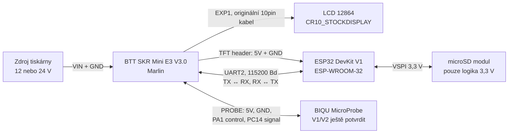

# Schéma zapojení prototypu

Toto schéma platí pro první prototyp:

- BTT SKR Mini E3 V3.0;
- ESP32 DevKit V1 / ESP-WROOM-32;
- externí microSD modul s logikou 3,3 V;
- LCD 12864 v režimu `CR10_STOCKDISPLAY`;
- BIQU MicroProbe, verze zatím neurčena.



## SKR ↔ ESP32

Použije se konektor TFT na SKR. Vždy se řiďte názvy signálů vytištěnými na
desce, ne pouze polohou vodiče na obrázku.

| SKR Mini E3 V3.0 | ESP32 DevKit V1 | Funkce |
|---|---|---|
| `TX2` / STM32 `PA2` | `GPIO16` / RX2 | Data z Marlinu do ESP |
| `RX2` / STM32 `PA3` | `GPIO17` / TX2 | G-code z ESP do Marlinu |
| `GND` | `GND` | Společná zem |
| `5V` | `5V` nebo `VIN` | Napájení prototypu |

TX se vždy kříží s RX. Nikdy nespojujte TX–TX ani RX–RX.

```text
SKR TX2 (PA2)  ─────────>  ESP GPIO16 (RX2)
SKR RX2 (PA3)  <─────────  ESP GPIO17 (TX2)
SKR GND         ─────────  ESP GND
SKR 5V          ──F1─────  ESP 5V/VIN
                         ┌─ 470 uF
                         └─ 100 nF
```

`F1` je doporučená vratná polyfuse přibližně 0,75–1 A. Kondenzátory se umístí
co nejblíže k pinům ESP. Před připojením se multimetrem ověří polarita a 5V
napětí.

## ESP32 ↔ microSD

| ESP32 | microSD | Poznámka |
|---|---|---|
| `3V3` | `VCC 3.3V` | Jen modul určený pro 3,3V logiku |
| `GND` | `GND` | Společná zem |
| `GPIO13` | `CS` | Chip select |
| `GPIO18` | `SCK/CLK` | VSPI clock |
| `GPIO23` | `MOSI/DI` | ESP → karta |
| `GPIO19` | `MISO/DO` | Karta → ESP |
| `GPIO34` | `CD` | Volitelná detekce karty, pouze vstup |

Vodiče SPI mají být krátké. GPIO0, 2, 5, 12 a 15 se pro periférie prototypu
nepoužijí kvůli bootovacím strapping funkcím. GPIO6–11 patří interní flash.

## LCD 12864

LCD se připojí samostatně k `EXP1` pomocí správně orientovaného originálního
10pin kabelu. V Marlinu je zapnuto:

```cpp
#define CR10_STOCKDISPLAY
```

Výstupek konektoru ani barva krajního vodiče nejsou spolehlivou náhradou za
kontrolu označení pinů. Obrácený kabel může displej poškodit.

## MicroProbe

Řídicí deska má pro sondu připravené signály:

- `PA1` — deploy/stow control (`SERVOS`);
- `PC14` — probe trigger;
- `5V` a `GND` — napájení sondy.

Konkrétní pořadí a barvy vodičů doplníme až po potvrzení MicroProbe V1 nebo V2
a podle manuálu konkrétní sondy. Do té doby se sonda nepřipojuje a probing
zůstává ve firmware vypnutý.

## Bezpečné první oživení

1. Odpojit motory, topení a sondu; ponechat pouze SKR, LCD a USB diagnostiku.
2. Ověřit 5V větev bez ESP.
3. Připojit ESP bez SD a zkontrolovat, že se stabilně spouští.
4. Připojit pouze UART a otestovat `M115` a `M105` bez pohybu.
5. Připojit SD a provést test zápisu a checksumu.
6. MicroProbe a pohybové části zapojovat až po potvrzení verze a mechanických
   parametrů tiskárny.

